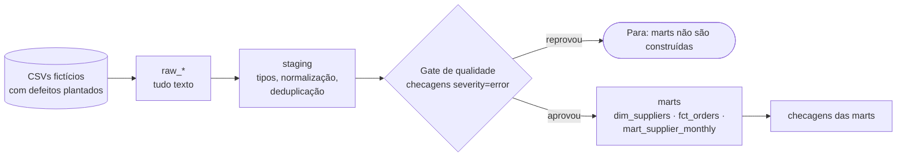

# elt-bigquery-data-quality

Exemplo didático de um **pipeline ELT com checagens de qualidade de dados** e **notas de particionamento e custo no BigQuery**. O pipeline roda localmente em DuckDB, com **dados 100% fictícios**, e o SQL das camadas pode ser renderizado para o dialeto do BigQuery.

O que ele mostra: carga bruta (raw), limpeza (staging), um **gate de qualidade** que bloqueia a construção das tabelas finais (marts) quando há erro, e o desenho de uma tabela particionada e clusterizada.

## Status

- [x] Pipeline local raw → staging → marts em DuckDB, com dados fictícios
- [x] Checagens de qualidade com severidade e **gate** (28 testes, incluindo contagens exatas dos defeitos plantados)
- [x] CI no GitHub Actions
- [ ] SQL executado em um BigQuery real
- [ ] Custo medido com dry run (consulta com e sem filtro de partição)
- [ ] Executor das checagens no BigQuery (hoje só o DuckDB executa)

> O dialeto do BigQuery é **renderizado e testado como texto**, mas nunca foi executado aqui. Os itens abertos serão marcados quando eu os fizer de fato.

## Como funciona



Os dados têm defeitos plantados de propósito (duplicados, fornecedor nulo ou inexistente, status inválido, quantidade negativa, total divergente da soma dos itens). Os testes conferem se as checagens encontram **exatamente** os números plantados.

## Como rodar

Requer Python 3.10 ou superior.

```bash
python -m venv .venv && source .venv/bin/activate   # Windows: .venv\Scripts\activate
pip install -r requirements.txt

python -m elt_dq run            # com defeitos: o gate reprova e as marts não são construídas
python -m elt_dq run --clean    # sem defeitos: o gate aprova e as marts são construídas
pytest
```

Não precisa de conta em nuvem nem de chave para nada disso.

Saída resumida da primeira execução:

```
staging  error             5  ERRO  not_null:stg_orders.supplier_id
staging  error             4  ERRO  relationships:stg_orders.supplier_id
staging  error             3  ERRO  range:stg_order_items.quantity
GATE REPROVADO: a staging tem erros; as marts NÃO foram construídas.
```

## Estrutura

```
elt_dq/            código: gerador de dados, dialetos, checagens, pipeline, CLI
sql/staging/       limpeza de cada tabela bruta
sql/marts/         tabelas finais (dimensão, fato, agregação mensal)
checks/checks.yml  regras de qualidade (tipo, tabela, severidade, estágio)
bigquery/          DDL com partição e cluster; consultas para comparar custo
scripts/           render_bigquery.py (gera SQL do BigQuery) e estimate_cost.py (dry run)
tests/             testes
docs/              notas de design e de custo
```

## Checagens disponíveis

| Tipo | O que conta como violação |
|---|---|
| `not_null` | valores nulos |
| `unique` | chaves repetidas (uma ou várias colunas) |
| `accepted_values` | valores fora da lista |
| `relationships` | chave sem correspondente na tabela pai |
| `range` | valores abaixo do mínimo ou acima do máximo |
| `freshness` | dado mais recente mais antigo que o limite (tabela vazia reprova) |
| `row_count_min` | tabela com menos linhas que o mínimo |
| `reconciliation` | soma de uma tabela diferente da soma de outra, além da tolerância |

Cada checagem é um SQL que devolve o número de violações; zero significa que passou. `severity: error` reprova o pipeline e `severity: warn` só aparece no relatório.

## BigQuery: partição e custo

- `bigquery/ddl_fct_orders.sql`: tabela fato particionada por `order_date` e clusterizada por `supplier_id, status`.
- `python scripts/render_bigquery.py --dataset projeto.dataset`: imprime o DDL e o `INSERT` já no dialeto do BigQuery.
- `bigquery/cost_demo_queries.sql` e `scripts/estimate_cost.py`: duas consultas e um script de dry run para comparar bytes processados.
- `docs/cost-notes.md`: o que a documentação do BigQuery diz sobre partição, cluster e custo, com as fontes.

## Limitações e decisões

- **DuckDB não é BigQuery.** Tipos, tratamento de datas e funções diferem. O SQL usa só construções comuns e três marcadores para o que muda (`SAFE_CAST` x `TRY_CAST`, `INT64` x `INTEGER`, `NUMERIC` x `DECIMAL`), mas isso não substitui rodar no BigQuery.
- **Sem carga incremental, sem orquestrador.** O pipeline recria as tabelas a cada execução.
- **Dados fictícios e pequenos** (centenas de linhas): partição e cluster só fazem diferença de verdade em tabelas grandes.
- **Checagens simples**, escritas à mão. Em um projeto real, vale avaliar ferramentas dedicadas (dbt tests, Great Expectations etc.).

## Licença

MIT. Veja `LICENSE`.
